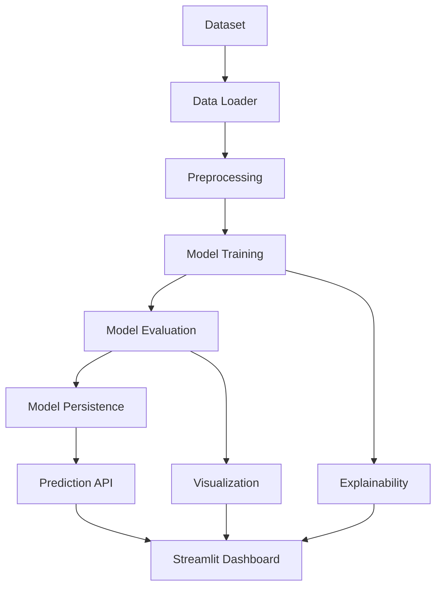

# Diabetes Risk Prediction System

An Explainable Machine Learning Application for Diabetes Risk Assessment

## Abstract

This project demonstrates the application of supervised machine learning for diabetes risk assessment using clinical and demographic measurements. The system implements a complete data processing pipeline, trains and evaluates multiple classification models, and provides an interactive web interface for risk prediction with model explainability.

## Problem Statement

Diabetes is a significant public health concern affecting millions of people worldwide. Machine learning can help demonstrate how clinical and demographic measurements relate to diabetes outcomes. This project uses the Pima Indians Diabetes dataset to train and evaluate supervised learning models and provide an interactive educational risk-assessment interface.

## Objectives

- Develop a web application that accepts patient measurements and validates inputs
- Process measurements using a saved machine learning pipeline
- Return calibrated predictions with supporting explanations
- Provide educational insights into model behavior and feature importance
- Demonstrate proper ML practices including data validation, preprocessing, and evaluation

## Scope

This is an academic decision-support demonstration, not a diagnostic tool. The application:
- Uses a publicly available dataset for educational purposes
- Implements standard ML preprocessing and evaluation techniques
- Provides interpretable model explanations
- Does not replace laboratory testing or qualified healthcare professionals
- Does not claim to provide definitive medical diagnoses

## System Architecture



The system follows a modular architecture with clear separation of concerns:

- **Data Loading**: Dataset ingestion, validation, and quality analysis
- **Preprocessing**: Missing value imputation and feature scaling
- **Training**: Model training with cross-validation and hyperparameter tuning
- **Evaluation**: Comprehensive metric calculation and visualization
- **Prediction**: Inference pipeline for new patient data
- **Explainability**: Feature importance and coefficient interpretation

## Dataset Details

### Source

Pima Indians Diabetes Database

The dataset can be obtained from:
- [UCI Machine Learning Repository](https://archive.ics.uci.edu/ml/datasets/pima+indians+diabetes)
- [Kaggle](https://www.kaggle.com/uciml/pima-indians-diabetes-database)

### Dataset Characteristics

- **Records**: 768 patients
- **Features**: 8 clinical and demographic measurements
- **Target**: Diabetes outcome (0 = negative, 1 = positive)
- **Population**: Pima Indian women (age 21+)

### Features Used

1. **Pregnancies**: Number of pregnancies
2. **Glucose**: Plasma glucose concentration (2 hours after oral glucose tolerance test) in mg/dL
3. **Blood Pressure**: Diastolic blood pressure in mm Hg
4. **Skin Thickness**: Triceps skin fold thickness in mm
5. **Insulin**: 2-Hour serum insulin in mu U/ml
6. **BMI**: Body mass index (weight in kg / (height in m)^2)
7. **Diabetes Pedigree Function**: Genetic diabetes score
8. **Age**: Age in years

### Data Quality Notes

- Zero values in Glucose, BloodPressure, SkinThickness, Insulin, and BMI are treated as missing values
- Missing values are imputed using median values from the training set
- Pregnancies can legitimately be zero and are not treated as missing
- The dataset contains some class imbalance

## Data Preprocessing

### Missing Value Handling

For features where zero indicates missing (Glucose, BloodPressure, SkinThickness, Insulin, BMI):
- Zeros are replaced with NaN
- Median imputation is applied within the training pipeline
- Imputation is fitted on training data only to prevent data leakage

### Feature Scaling

- StandardScaler is applied to all numerical features
- Scaling is fitted on training data only
- Same scaling parameters are applied to test and prediction data

### Train/Test Split

- Stratified 80/20 split
- Random state: 42 for reproducibility
- Preserves class distribution in both sets

## Algorithms Used

Three supervised learning algorithms were trained and compared:

### 1. Logistic Regression

- Linear classifier with interpretable coefficients
- Uses L2 regularization
- Class weighting to handle imbalance
- Maximum iterations: 1000

### 2. Decision Tree

- Non-linear classifier with clear decision rules
- Maximum depth: 10
- Minimum samples split: 5
- Class weighting to handle imbalance

### 3. Random Forest

- Ensemble method combining multiple decision trees
- Number of estimators: 100
- Maximum depth: 10
- Minimum samples split: 5
- Class weighting to handle imbalance

## Model Training Methodology

### Cross-Validation

- 5-fold stratified cross-validation on training set
- ROC-AUC as the primary evaluation metric
- Helps assess model stability and generalization

### Hyperparameter Tuning

- Limited manual tuning based on dataset characteristics
- Focus on preventing overfitting (depth limits, minimum samples)
- Class weighting to address imbalance

### Model Selection

- Primary criterion: Highest ROC-AUC score on test set
- Secondary considerations: Precision, Recall, F1-Score
- Final model is saved with complete preprocessing pipeline

## Evaluation Metrics

The following metrics are calculated for each model:

- **Accuracy**: (TP + TN) / (TP + TN + FP + FN)
- **Precision**: TP / (TP + FP)
- **Recall/Sensitivity**: TP / (TP + FN)
- **Specificity**: TN / (TN + FP)
- **F1-Score**: 2 × (Precision × Recall) / (Precision + Recall)
- **ROC-AUC**: Area under the Receiver Operating Characteristic curve
- **Average Precision**: Area under the Precision-Recall curve
- **Brier Score**: Mean squared error of probability predictions

### Confusion Matrix

- True Positives (TP): Correctly predicted positive cases
- True Negatives (TN): Correctly predicted negative cases
- False Positives (FP): Incorrectly predicted positive cases
- False Negatives (FN): Incorrectly predicted negative cases

## Application Features

### Dashboard

- Project overview and model status
- Dataset summary statistics
- Selected model information
- Test-set performance metrics
- Model comparison visualization
- Clear medical disclaimer

### Diabetes Risk Prediction

- Organized input form for all 8 features
- Input validation with bounds checking
- Distinguishes between valid zeros and missing values
- Single explicit Predict button
- Displays predicted class and probability
- Shows classification threshold
- Includes model information
- Clear non-diagnostic language

### Model Performance

- Model comparison table
- Confusion matrix visualization
- ROC curve
- Precision-recall curve
- Classification metrics
- Training methodology documentation
- Known model limitations

### Dataset Explorer

- Dataset preview
- Feature descriptions
- Summary statistics
- Missing-value analysis
- Target distribution
- Interactive charts

### Explainability

- Feature importance visualization
- Coefficient interpretation (for Logistic Regression)
- Clear explanation of limitations
- Distinction between correlation and causation

### Project Information

- Problem statement and objectives
- System architecture
- Dataset details
- Algorithms and methodology
- Results and limitations
- Ethical considerations
- References

## Installation Instructions

### Prerequisites

- Python 3.11 or higher
- pip package manager

### Environment Setup

#### Windows PowerShell

```powershell
# Create virtual environment
python -m venv .venv

# Activate virtual environment
.venv\Scripts\Activate.ps1

# Install dependencies
python -m pip install -r requirements.txt
```

#### Linux/macOS

```bash
# Create virtual environment
python -m venv .venv

# Activate virtual environment
source .venv/bin/activate

# Install dependencies
python -m pip install -r requirements.txt
```

## Dataset Setup

1. Download the Pima Indians Diabetes dataset from:
   - UCI Machine Learning Repository or
   - Kaggle

2. Place the CSV file as `diabetes.csv` in the `data/` directory

3. Ensure the file contains the required columns:
   - Pregnancies, Glucose, BloodPressure, SkinThickness, Insulin, BMI, DiabetesPedigreeFunction, Age, Outcome

## Model Training Instructions

After setting up the environment and dataset:

```bash
# Train the models
python -m src.train
```

This will:
1. Load and validate the dataset
2. Perform data quality analysis
3. Train and evaluate three models
4. Select the best model based on ROC-AUC
5. Save the model pipeline to `models/diabetes_model.joblib`
6. Save evaluation metrics to `reports/evaluation_metrics.json`
7. Generate visualization HTML files in the `reports/` directory

## Application Execution Instructions

After training the model:

```bash
# Launch the Streamlit application
python -m streamlit run app.py
```

The application will open in your default web browser at `http://localhost:8501`

## Test Execution Instructions

To run the test suite:

```bash
# Run all tests
python -m pytest -q

# Run with coverage
python -m pytest --cov=src --cov-report=html
```

## Project Directory Structure

```
diabetes-risk-prediction/
├── app.py                          # Streamlit application
├── requirements.txt                # Python dependencies
├── pyproject.toml                  # Project configuration
├── .gitignore                      # Git ignore rules
├── README.md                       # This file
├── src/
│   ├── __init__.py
│   ├── config.py                   # Configuration constants
│   ├── data_loader.py              # Dataset loading and validation
│   ├── preprocessing.py            # Data preprocessing pipeline
│   ├── train.py                    # Model training and evaluation
│   ├── predict.py                  # Prediction module
│   ├── explainability.py           # Model explainability
│   └── visualization.py            # Visualization utilities
├── data/
│   ├── README.md                   # Dataset documentation
│   └── diabetes.csv                # Dataset (user-provided)
├── models/
│   ├── README.md                   # Models documentation
│   └── diabetes_model.joblib       # Trained model (generated)
├── reports/
│   ├── README.md                   # Reports documentation
│   ├── evaluation_metrics.json     # Metrics (generated)
│   ├── confusion_matrix.html      # Visualizations (generated)
│   ├── roc_curve.html
│   ├── precision_recall_curve.html
│   ├── model_comparison.html
│   └── feature_importance.html
├── tests/
│   ├── __init__.py
│   ├── test_data_loader.py
│   ├── test_preprocessing.py
│   ├── test_training.py
│   └── test_prediction.py
└── notebooks/
    └── exploratory_analysis.ipynb  # Optional EDA notebook
```

## Demonstration Workflow for Presentation

### Setup

1. Show project structure and configuration files
2. Display dataset information and source
3. Explain data preprocessing approach

### Training

1. Run `python -m src.train`
2. Show data quality analysis output
3. Display model comparison results
4. Explain model selection rationale

### Application Demo

1. Run `python -m streamlit run app.py`
2. Navigate to Dashboard page - show model status and metrics
3. Navigate to Dataset Explorer - show data distribution
4. Navigate to Prediction page - demonstrate input and prediction
5. Navigate to Model Performance - show evaluation visualizations
6. Navigate to Explainability - show feature importance
7. Navigate to Project Info - summarize the system

### Key Points to Highlight

- Proper data validation and preprocessing
- Model comparison and selection process
- Comprehensive evaluation metrics
- Explainable AI approach
- Clear medical disclaimers
- Reproducible training pipeline

## Limitations

### Dataset Limitations

- The dataset is specific to Pima Indian women and may not generalize to other populations
- Small sample size (768 records) limits statistical power
- Missing values were imputed, which may introduce bias
- The dataset is from the 1990s and may not reflect current clinical practices

### Model Limitations

- Models are trained on a single dataset without external validation
- Class imbalance may affect performance metrics
- The model does not account for all diabetes risk factors
- Predictions are probabilistic and should be interpreted with caution
- The classification threshold (0.5) may not be optimal for clinical use

### Application Limitations

- This is an academic demonstration, not a clinically validated tool
- Predictions should not replace professional medical advice
- The system does not integrate with electronic health records
- No temporal or longitudinal predictions are supported
- Batch prediction requires manual CSV upload

## Ethical Considerations

### Privacy

- No personal identifiers are collected or stored
- Patient measurements are not logged or saved by default
- The application does not send data to external services
- Model artifacts are stored locally

### Transparency

- Model limitations are clearly communicated
- Medical disclaimers are prominently displayed
- Evaluation methodology is documented
- Feature importance is provided with caveats

### Responsibility

- The application is designed for educational purposes only
- Users are advised to consult healthcare professionals
- The system does not claim to provide medical diagnoses
- No clinical validation has been performed

## Future Enhancements

### Data

- Integration with additional clinical datasets
- More sophisticated imputation strategies
- Feature engineering based on domain knowledge
- Temporal data for longitudinal predictions

### Models

- Calibration of probability estimates
- Ensemble methods with more diverse algorithms
- Neural network architectures
- Bayesian approaches for uncertainty quantification

### Application

- Integration with electronic health records
- Prospective clinical validation
- Multi-language support
- Mobile application
- Real-time prediction API

### Explainability

- SHAP (SHapley Additive exPlanations) integration
- Counterfactual explanations
- Local vs global explanation separation
- Interactive explanation interface

## References

- UCI Machine Learning Repository. Pima Indians Diabetes Database.
- Scikit-learn: Machine Learning in Python.
- Streamlit: The fastest way to build data apps.
- Peduzzi, P., et al. (1996). A simulation study of the number of events per variable in logistic regression analysis.
- American Diabetes Association. Standards of Medical Care in Diabetes.

## License

This project is provided for educational purposes. Please ensure you have appropriate rights to use the dataset.

## Contact

For questions or issues, please refer to the project repository or contact the development team.

---

**Important Medical Disclaimer**: This application is an academic decision-support demonstration, not a diagnostic tool. It does not replace laboratory testing or qualified healthcare professionals. A predicted probability is not necessarily a person's true clinical probability of developing diabetes.
